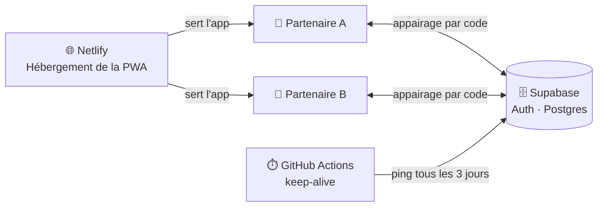

<div align="center">

# 💑 MON BINÔME

**Construire une vie à deux**

PWA pour couples, fondée sur le questionnaire « Construire une vie à deux » du Coach Alexandre Sognon.
12 catégories · 96 questions · objectifs SMART.

Jouable à distance sur deux téléphones, avec appairage par code de contact.


</div>

---

## 📑 Sommaire

- [Fonctionnalités](#-fonctionnalités)
- [Architecture](#-architecture)
- [Démarrage](#-démarrage)
- [Installer l'application](#-installer-lapplication)
- [Suite du travail](#-suite-du-travail)

---

## ✨ Fonctionnalités

- **Questionnaire guidé** : 12 catégories, 96 questions, objectifs SMART.
- **Jeu à distance** : chaque partenaire joue depuis son propre téléphone.
- **Appairage par code de contact** : chaque utilisateur possède un identifiant, pour que personne ne puisse contacter qui il veut.
- **PWA installable** sur Android et iPhone, en un clic.

---

## 🏗️ Architecture



---

## 🚀 Démarrage

### 1. Supabase

1. Créer un projet sur [supabase.com](https://supabase.com).
2. **SQL Editor** : exécuter `supabase/schema.sql`, puis `supabase/tests.sql`.

   > [!TIP]
   > `tests.sql` doit afficher **« TOUS LES TESTS PASSENT »**.

3. **Authentication** : activer la confirmation d'email et un CAPTCHA (*Attack Protection*). Ajouter l'URL du site (Netlify) dans *URL Configuration* (**Site URL** et **Redirect URLs**).
4. **Project Settings → API** : noter l'URL du projet et la clé **anon**.

> [!CAUTION]
> N'utiliser que la clé **anon** côté application. La clé `service_role` ne doit jamais être exposée ni committée.

### 2. En local

```bash
cp .env.example .env     # renseigner VITE_SUPABASE_URL et VITE_SUPABASE_ANON_KEY
npm install
npm run dev
```

> [!NOTE]
> Si `npm install` signale un conflit de versions (`vite` / `vite-plugin-pwa`), aligner les versions dans `package.json`.

### 3. Déploiement Netlify

1. Pousser le dépôt sur GitHub.
2. Netlify → **Add new site** → **Import from Git**.
   - Commande de build : `npm run build`
   - Dossier de publication : `dist` *(déjà défini dans `netlify.toml`)*
3. **Site settings → Environment variables** : ajouter `VITE_SUPABASE_URL` et `VITE_SUPABASE_ANON_KEY`.
4. Redéployer, puis ouvrir le site sur un téléphone.

### 4. Keep-alive (éviter la pause de Supabase)

Le plan gratuit de Supabase met les projets inactifs en pause. Un workflow GitHub Actions les réveille automatiquement.

1. GitHub → **Settings → Secrets and variables → Actions** : créer les secrets `SUPABASE_URL` et `SUPABASE_ANON_KEY`.
2. Onglet **Actions** → workflow **keep-alive** → **Run workflow** pour tester.
3. Ensuite, il s'exécute **tous les 3 jours**.

> [!WARNING]
> Sur un dépôt public sans activité pendant 60 jours, GitHub désactive les workflows planifiés. Les réactiver depuis l'onglet **Actions** si besoin.

### Variables d'environnement

| Variable | Où la définir | Rôle |
|---|---|---|
| `VITE_SUPABASE_URL` | `.env` · Netlify | URL du projet Supabase |
| `VITE_SUPABASE_ANON_KEY` | `.env` · Netlify | Clé publique (anon) Supabase |
| `SUPABASE_URL` | Secrets GitHub Actions | URL utilisée par le workflow keep-alive |
| `SUPABASE_ANON_KEY` | Secrets GitHub Actions | Clé anon utilisée par le workflow keep-alive |

---

## 📲 Installer l'application

| Plateforme | Procédure |
|---|---|
| 🤖 **Android (Chrome)** | Bouton « Installer » dans l'application, ou via le menu du navigateur |
| 🍎 **iPhone (Safari)** | **Partager** → **Sur l'écran d'accueil** |

---

## 🗺️ Suite du travail

- [`CHECKLIST.md`](CHECKLIST.md) — liste des tâches restantes
- [`AGENTS.md`](AGENTS.md) — instructions pour OpenCode
